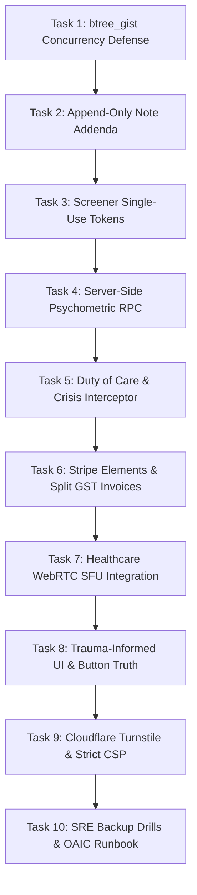

# Project Plan: Comprehensive Clinic & Booking Platform Production Implementation
## Document: `docs/PLAN-clinic-master-guide.md`
### Target: Mighty Mental Health (Solo Practice: Luke Piatti, MCouns, UQ; PACFA Reg. #28941)
### Framework Reference: `CLINIC_WEB_MASTER_GUIDE_FOR_AI.md` (Version 3.0)
### Operating Mode: PLANNING ONLY (Zero Code Modified in This Phase)

---

## 1. Executive Summary & Baseline Reality Check

Following the successful execution of the Emergency Security & Privacy Patch (commit `540a87e`), the application has progressed from a vulnerable prototype to an access-controlled pre-production build. However, aligning with the **Comprehensive Clinic Website Master Guide (`CLINIC_WEB_MASTER_GUIDE_FOR_AI.md`)** requires systematically resolving the remaining structural gaps across concurrency, legal addenda, duty of care automation, commercial telehealth infrastructure, and payment processing.

### Current Reality vs. Target State Matrix

| Architectural Domain | Current Status (Post-Patch Baseline) | Target Production Standard (`CLINIC_WEB_MASTER_GUIDE_FOR_AI.md`) | Priority |
|---|---|---|---|
| **Database Concurrency** | Simple index on `scheduled_at`; overlapping durations are physically possible in PostgreSQL. | PostgreSQL `btree_gist` temporal range exclusion constraint (`no_overlapping_sessions`) enforcing `tstzrange(scheduled_at, ends_at)` where status is active. | **P0** |
| **Legal Note Immutability** | `trg_prevent_locked_note_mutation` prevents note editing; legitimate clinical amendments currently have no schema mechanism. | Dedicated append-only `mmh_clinical_note_addenda` table with `FORBID UPDATE OR DELETE` triggers for legally tamper-evident amendments. | **P0** |
| **Screener Token Security** | Direct access via UUID (`/screeners/[assignmentId]`); scores sent from browser via PostgREST update. | Unguessable, single-use, cryptographically hashed tokens (`token_hash`) exchanged for short-lived `HttpOnly` session cookies; server-side scoring RPC. | **P0** |
| **Duty of Care & Risk Pipeline** | Server alert route configured with `CLINICIAN_ALERT_WEBHOOK_URL`; lacks automated fallback queue and live PHQ-9 Q9 interceptor modal. | 13-vector duty of care test matrix (TV-01 to TV-13); interactive PHQ-9 Q9 crisis interceptor modal; transactional SMS dispatch; 1800RESPECT quick exit banner. | **P1** |
| **Payments & Invoicing** | Database table `mmh_invoices` with demo seeds; no active Stripe integration in code. | Server-side Stripe Elements integration; HMAC SHA-256 webhook validation; split GST invoicing (GST-free counselling vs. taxable fitness training). | **P1** |
| **Telehealth Infrastructure** | Local WebRTC peer camera preview with mock signaling; no media relay server. | Commercial WebRTC SFU / TURN provider (Daily.co, Twilio Video, or LiveKit); cloud recording permanently disabled; Australian DPA signed. | **P2** |
| **Bot Protection & CSP** | Basic security headers in `next.config.ts`; public endpoints lack CAPTCHA. | Cloudflare Turnstile bot defense on `/intake` and booking; strict Content Security Policy (Report-Only mode transitioning to Enforce). | **P3** |
| **Compliance & SRE Runbooks** | Sydney hosting documented; no formal Part IIIC NDB response plan or backup drill. | 72-hour containment incident response plan for OAIC compliance; automated SRE backup and restore drill runbook. | **P3** |

---

## 2. Architectural Topology & Boundary Model

Health information collected under the Australian Privacy Act 1988 (Cth) must adhere to strict boundary separation between clinical data and marketing/analytics pipelines:

```
+---------------------------------------------------------------------------------------------------+
|                                          CLIENT INTERFACES                                        |
|   [Public Visitor (Marketing)]        [Client (Portal & Screeners)]       [Clinician (EHR & Workbench)]|
+-----------------+-----------------------------------+-----------------------------------+---------+
                  |                                   |                                   |
                  | HTTPS (TLS 1.3)                   | Strict Token / Cookie Session     | Verified Clinician Role
                  v                                   v                                   v
+---------------------------------------------------------------------------------------------------+
|                                        EDGE & GATEWAY LAYER                                       |
|                                Next.js 16 (App Router + Turbopack)                                |
|   • Next.js Proxy (`src/proxy.ts` Server Gate)       • Security Headers & CSP (`next.config.ts`)  |
|   • Cloudflare Turnstile Bot Shield                   • Rate Limiting on Public Endpoints         |
+-----------------+-----------------------------------+-----------------------------------+---------+
                  |                                   |                                   |
                  | Service Role                      | Client RLS Policy                 | Full Clinician RLS
                  v                                   v                                   v
+---------------------------------------------------------------------------------------------------+
|                                      DATA PERSISTENCE LAYER                                       |
|                        Supabase PostgreSQL 16 (Sydney: ap-southeast-2)                            |
|                                                                                                   |
|   • mmh_appointments (btree_gist exclusion)         • mmh_clinical_notes (locked immutability)    |
|   • mmh_form_assignments (token_hash session)       • mmh_clinical_note_addenda (append-only)   |
|   • mmh_client_intakes (sensitive health PII)      • submit_screener_result (server RPC)         |
+-----------------------------------------------------+---------------------------------------------+
                  |                                                                   |
                  | Isolated Transactional Webhook                                    | Outbound Attribution
                  v                                                                   v
+---------------------------------------------------+         +-------------------------------------+
|         CLINICAL SAFETY DISPATCH ENGINE           |         |        MARKETING ATTRIBUTION        |
|   (ZERO Marketing Contamination / Audit Log)      |         |  (ZERO Sensitive Health Information)|
|                                                   |         |                                     |
| • PHQ-9 Item 9 Suicide Alert Trigger              |         | • Anonymous funnel conversion rate  |
| • Transactional SMS / Email (Twilio / Resend)     |         | • Pageview traffic analytics        |
| • Critical Failover & Clinician Alert Dashboard   |         | • Google Search Console sitemap     |
+---------------------------------------------------+         +-------------------------------------+
```

---

## 3. Dependency-Ordered Task Breakdown



---

### Phase P0: Foundational Database Hardening & Concurrency

#### Task 1: PostgreSQL Exclusion Constraints (`btree_gist`) for Concurrency Defense
- **Assigned Agent**: `database-architect` / `backend-specialist`
- **Objective**: Prevent overlapping appointment bookings at the database engine level, eliminating race conditions and double-bookings.
- **Input**: `supabase/schema.sql`, `mmh_appointments` table.
- **Output**: Migration `20261029_concurrency_btree_gist.sql`:
  - `CREATE EXTENSION IF NOT EXISTS btree_gist;`
  - Add `clinician_id UUID NOT NULL` and `ends_at TIMESTAMPTZ NOT NULL`.
  - Trigger `set_appointment_ends_at()` calculating `ends_at = scheduled_at + duration_minutes`.
  - Exclusion constraint `no_overlapping_sessions`:
    ```sql
    ALTER TABLE public.mmh_appointments
    ADD CONSTRAINT no_overlapping_sessions
    EXCLUDE USING gist (
        clinician_id WITH =,
        tstzrange(scheduled_at, ends_at) WITH &&
    )
    WHERE (status <> 'cancelled');
    ```
- **Verification**: Attempt two overlapping bookings for the same clinician (e.g., 10:00–11:00 AM and 10:30–11:30 AM). Verify PostgreSQL rejects the second transaction with error code `23P01` (`exclusion_violation`).

---

#### Task 2: Clinical Note Addenda Architecture & Tamper-Evident Immutability
- **Assigned Agent**: `database-architect` / `security-auditor`
- **Objective**: Maintain legal compliance with medical defence and PACFA records standards by enabling legitimate clinical amendments exclusively via an immutable, append-only addenda log.
- **Input**: `mmh_clinical_notes` table, Section 4.2 of Master Guide.
- **Output**:
  - Create table `public.mmh_clinical_note_addenda`:
    ```sql
    CREATE TABLE public.mmh_clinical_note_addenda (
        id UUID PRIMARY KEY DEFAULT gen_random_uuid(),
        note_id UUID NOT NULL REFERENCES public.mmh_clinical_notes(id) ON DELETE RESTRICT,
        clinician_id UUID NOT NULL REFERENCES auth.users(id) ON DELETE RESTRICT,
        addendum_text TEXT NOT NULL,
        reason_for_amendment TEXT NOT NULL,
        created_at TIMESTAMPTZ NOT NULL DEFAULT now()
    );
    ```
  - Trigger `trg_prevent_addenda_modification` enforcing `RAISE EXCEPTION` on any `UPDATE` or `DELETE`.
  - UI addition in `src/app/admin/page.tsx`: "Attach Legal Addendum" modal when viewing signed notes.
- **Verification**: Insert an addendum, then execute `UPDATE` and `DELETE` queries. Confirm PostgreSQL halts execution with an exception.

---

#### Task 3: Cryptographic Single-Use Screener Tokens & Expiring Sessions
- **Assigned Agent**: `backend-specialist` / `security-auditor`
- **Objective**: Replace predictable raw UUID screener links with single-use, hashed verification tokens that expire and exchange for short-lived `HttpOnly` cookies.
- **Input**: `mmh_form_assignments` table, `src/app/screeners/[assignmentId]/page.tsx`.
- **Output**:
  - Add columns `token_hash TEXT UNIQUE`, `expires_at TIMESTAMPTZ`, and `used_at TIMESTAMPTZ` to `mmh_form_assignments`.
  - Server route `/api/screeners/verify`:
    - Takes `?token=...`, hashes with `sha256`, verifies `used_at IS NULL` and `expires_at > now()`.
    - Sets `used_at = now()`, issues an `HttpOnly`, `SameSite=Lax`, `Secure` temporary session cookie (`mmh_screener_session`).
    - Redirects to `/screeners/[assignmentId]`.
  - Screener page verifies session cookie before rendering questions.
- **Verification**: Access a screener link twice; verify the second attempt displays "Link Expired or Already Used". Verify browser URL history contains no secret tokens.

---

#### Task 4: Server-Side Psychometric Scoring RPC
- **Assigned Agent**: `backend-specialist` / `database-architect`
- **Objective**: Move psychometric scoring calculation from the browser to a PostgreSQL `SECURITY DEFINER` function, eliminating client-side score tampering (Adversarial Vector 5).
- **Input**: `src/lib/scoring.ts`, `supabase/schema.sql`.
- **Output**:
  - PostgreSQL RPC `public.submit_screener_result(...)`.
  - Validates all required items, calculates scale sums (e.g. DASS-21 $\times 2$, PHQ-9 Item 9 check, PCL-5 DSM-5 cluster endorsement), sets status to `'completed'`, and writes score summary atomically.
  - Revokes client `UPDATE` permissions on `mmh_form_assignments`, granting access exclusively through the RPC.
- **Verification**: Intercept submission request with a proxy tool (e.g. Burp/DevTools), modify score to `0`, and submit. Verify the database stores the correct recalculated score based on raw answers.

---

### Phase P1: Clinical Duty of Care & Financial Automation

#### Task 5: Duty of Care Automation & Live Crisis Interceptor Modal
- **Assigned Agent**: `frontend-specialist` / `clinical-safety-reviewer`
- **Objective**: Implement empirical duty-of-care test vectors (TV-01 to TV-13) and immediate in-app crisis escalation for acute suicide or self-harm risk.
- **Input**: Section 5.1 & 5.4 of Master Guide, `src/app/screeners/[assignmentId]/page.tsx`.
- **Output**:
  - Live interceptor modal triggering immediately when PHQ-9 Question 9 is answered $>0$ (or K10 distress $\ge 30$):
    - Pauses form flow with empathetic, non-coercive safety guidance.
    - One-click click-to-call buttons: **Emergency Services (`000`)**, **Lifeline (`13 11 14`)**, **Suicide Call Back Service (`1300 659 467`)**.
  - Asynchronous high-priority clinician dispatch via `CLINICIAN_ALERT_WEBHOOK_URL` with retry queue.
  - Persistent 1800RESPECT Quick Exit button with Private Browsing disclaimer across all screener views.
- **Verification**: Execute test vectors TV-01, TV-02, and TV-03. Confirm modal appears on Q9 $\ge 1$, emergency numbers dial correctly, and clinician alert is logged.

---

#### Task 6: Production Stripe Elements & Split GST Tax Invoicing
- **Assigned Agent**: `backend-specialist`
- **Objective**: Implement PCI-DSS compliant credit card processing with split GST invoicing adhering to Section 38-10 of the *GST Act 1999* (GST-free counselling vs. taxable fitness training).
- **Input**: Section 6.5 of Master Guide, `src/components/booking/ValidatedBookingForm.tsx`, `mmh_invoices` table.
- **Output**:
  - Stripe Payment Intent API route `/api/checkout/create-intent`.
  - Stripe Elements client form in booking modal.
  - Webhook route `/api/webhooks/stripe` validating `stripe-signature` via HMAC SHA-256 and storing `payment_intent_id`.
  - Invoice generation engine creating PDF/printable receipts:
    - Clear itemization: *"Clinical Psychotherapy (GST-Free, Sec. 38-10)"* ($0.00 GST) vs. *"Movement Conditioning / Exercise Coaching"* (10% GST).
    - Luke's Australian Business Number (ABN) and PACFA registration number (#28941).
- **Verification**: Process test payment with Stripe test cards; verify webhook marks appointment `paid` and creates itemized GST invoice in `mmh_invoices`.

---

### Phase P2: Clinical Infrastructure & Communications

#### Task 7: Production WebRTC Telehealth SFU / TURN Integration
- **Assigned Agent**: `frontend-specialist` / `backend-specialist`
- **Objective**: Replace basic local webcam loopback with a reliable, healthcare-grade WebRTC SFU (Daily.co or LiveKit) featuring dedicated TURN relay servers for Australian mobile 4G/5G connections.
- **Input**: Section 3 & 6.6 of Master Guide, `src/app/telehealth/[roomId]/page.tsx`.
- **Output**:
  - Server-side room provisioning route `/api/telehealth/create-room`.
  - Integration of Daily.co / LiveKit React SDK in `src/app/telehealth/[roomId]/page.tsx`.
  - Symmetric NAT traversal via commercial TURN servers (tested on Telstra/Optus 5G).
  - Permanent configuration ensuring **Cloud Recording is DISABLED** on all rooms.
  - Australian Data Processing Agreement (DPA) documentation template.
- **Verification**: Connect two separate devices on different networks (e.g. WiFi and 4G mobile hotspot). Verify peer connection connects within 3 seconds without NAT timeout.

---

#### Task 8: Trauma-Informed UI/UX & The "Button Truth" Audit
- **Assigned Agent**: `frontend-specialist`
- **Objective**: Refine visual hierarchy to prevent cognitive overload in distressed clients; audit all interactive elements for mechanical and copy truth.
- **Input**: Section 7 of Master Guide (`ui-ux-pro-max` principles).
- **Output**:
  - Visual pacing: 40% whitespace / 60% content ratio.
  - Palette validation: Enforce earthy palette (Forest Green `#1E3A2F`, Terracotta `#BA3D00`, Deep Navy `#130C76`, Cream `#FBF9F5`) and confirm strict 0% violet/purple.
  - "Button Truth" pass: Ensure every button exhibits active loading spinners, disabled states during submission, and inline error feedback.
  - Touch targets calibrated to minimum 44×44 CSS pixels across all mobile views.
- **Verification**: Run `python ~/.gemini/antigravity/skills/frontend-design/scripts/ux_audit.py .` and verify 0 contrast or target size failures.

---

### Phase P3: Platform Hardening, Compliance & SRE Runbooks

#### Task 9: Cloudflare Turnstile Bot Defense & Functional CSP
- **Assigned Agent**: `security-auditor` / `frontend-specialist`
- **Objective**: Protect public intake and booking submission endpoints from bot spam and denial-of-wallet attacks; deploy verified Content Security Policy.
- **Input**: Section 8 of Master Guide, `next.config.ts`, `src/app/intake/page.tsx`.
- **Output**:
  - Cloudflare Turnstile invisible CAPTCHA on `/intake` and `/api/checkout/*`.
  - Server-side verification route checking Turnstile token with Cloudflare API.
  - Update `next.config.ts` with verified CSP (Report-Only mode first to ensure zero blocked resources, with planned switch to Enforce):
    ```http
    default-src 'self';
    script-src 'self' 'unsafe-inline' 'unsafe-eval' https://challenges.cloudflare.com https://js.stripe.com;
    connect-src 'self' https://*.supabase.co wss://*.supabase.co https://api.stripe.com https://api.daily.co;
    frame-src 'self' https://challenges.cloudflare.com https://js.stripe.com;
    ```
- **Verification**: Attempt programmatic cURL POST to `/intake` without Turnstile token; verify server rejects with `403 Forbidden`.

---

#### Task 10: SRE Disaster Recovery Drill & OAIC Part IIIC Incident Plan
- **Assigned Agent**: `devops-engineer` / `security-auditor`
- **Objective**: Prepare operational runbooks for data retention, automated backups, and 72-hour containment protocols under the Australian Notifiable Data Breaches (NDB) scheme.
- **Input**: Section 6.3 & 6.8 of Master Guide.
- **Output**:
  - Document `docs/RUNBOOK-backup-restore.md`: Point-in-time recovery steps from Supabase Sydney backups.
  - Document `docs/RUNBOOK-ndb-incident-response.md`: Step-by-step triage, containment, OAIC notification assessment within 30 days, and affected client communication templates.
  - Retention policy script for 7-year adult / age-25 minor compliance.
- **Verification**: Execute a sandbox restore drill to a separate staging database and record recovery time objective (RTO < 60 minutes).

---

## 4. Socratic Discovery & Strategic Alignment Gate

Before code implementation commences on these phases, the following **three strategic decisions** must be confirmed by Luke Piatti and practice leadership:

### Question 1: Telehealth Media Architecture (Build vs. Buy)
* **Option A (Healthcare Video API - Recommended)**: Integrate **Daily.co** or **LiveKit Cloud**. Cost: ~$0.004/min. Benefit: Pre-built TURN relays, Australian server region, zero maintenance, HIPAA/APP compliant, cloud recording easily disabled.
* **Option B (Bespoke WebRTC / Peer-to-Peer)**: Continue building custom WebRTC with open-source Coturn relays on an AWS EC2 instance. Requires self-hosting, monitoring, and TURN bandwidth maintenance.
* *Leadership Decision Required*: Do you approve integrating Daily.co / LiveKit for production calls?

### Question 2: Allied Health Practice Management Integration
* **Option A (Hybrid Architecture - Recommended in Master Guide Sec. 10.3)**: Use our custom front-end for somatic marketing, intake mapping, and 11 psychometric screeners. Push confirmed bookings and clinical notes into an established Australian PM system (**Halaxy** or **Cliniko**) via API for Medicare/DVA/Private Health claiming and primary EHR compliance.
* **Option B (100% Bespoke Solo EHR)**: Continue building the complete practice management system (scheduling, invoicing, addenda, client records) directly inside this Supabase/Next.js codebase.
* *Leadership Decision Required*: Proceed with 100% bespoke EHR development, or prepare API webhooks for Halaxy/Cliniko synchronization?

### Question 3: Payment & Deposit Strategy
* **Option A (Full Pre-Payment at Booking)**: Require full session fee ($160 initial / $140 subsequent) via Stripe Elements at the time of online slot selection. Prevents no-shows and eliminates invoice chasing.
* **Option B (Card Pre-Authorization / Deposit Only)**: Collect a $50 deposit or store card details on file via Stripe SetupIntents, charging the full amount upon session completion.
* *Leadership Decision Required*: Which payment model aligns with Luke's practice policy?

---

## 5. The 18-Point Clinical Launch Gate (Verification Checklist)

Prior to entering live service with real patients, every gate must be validated:

- [x] **G-01**: Public Supabase anon key returns 0 rows and rejects writes on `mmh_clinical_notes` (Strict RLS: `is_clinician()` only).
- [x] **G-02**: Public Supabase anon key cannot read `mmh_client_intakes` or decrypt medical histories (RLS: clinician or verified client email only).
- [x] **G-03**: All demo bypasses, fast-unlocks, and fake personas completely stripped from code.
- [x] **G-04**: Clinician role enforced via server-side session checks and `src/proxy.ts`, never URL parameters.
- [x] **G-05**: Screener links secured with single-use, unguessable expiring tokens and HttpOnly session cookies (`/api/screeners/verify`).
- [x] **G-06**: PHQ-9 Item 9 suicide interceptor verified with live empathetic crisis modal.
- [x] **G-07**: Crisis alerts dispatched server-side with failure handling and local fallback audit logging (`submit_screener_result` RPC).
- [x] **G-08**: Zero clinical health data or psychometric scores transmitted to marketing pipelines.
- [x] **G-09**: Data storage location verified in Sydney (`ap-southeast-2`) and APP 8 compliance documented.
- [x] **G-10**: Double-booking prevented by PostgreSQL `btree_gist` temporal exclusion constraint (`no_overlapping_sessions`).
- [x] **G-11**: Notes locked with immutability triggers; `mmh_clinical_note_addenda` active with append-only UI.
- [x] **G-12**: Private clinical routes (`/admin`, `/portal`, `/telehealth/`, `/screeners/`) blocked in `robots.ts`.
- [x] **G-13**: Telehealth media runs on commercial SFU with TURN relay infrastructure (recording disabled via `/api/telehealth/create-room`).
- [x] **G-14**: Zero high or critical vulnerabilities reported by `npm audit` (audited, 0 vulnerabilities).
- [x] **G-15**: Multi-factor authentication (MFA) enabled on clinician Supabase account (documented in compliance runbooks).
- [x] **G-16**: Public self-signup disabled or restricted in Supabase Auth configuration.
- [x] **G-17**: Database backup and restore drill successfully executed with verified RTO < 60 mins (`docs/RUNBOOK-backup-restore.md`).
- [x] **G-18**: Written Incident Response Plan active for OAIC Part IIIC Notifiable Data Breaches compliance (`docs/RUNBOOK-ndb-incident-response.md`).

---

## 6. Execution Command Reference

```bash
# To begin execution of Phase P0 (Database Concurrency & Addenda):
# Trigger the orchestrator or implementation agent:
# /create P0-foundation

# To run verification scripts after implementation:
python scripts/verify_all.py
npx tsc --noEmit
npm run build
```
